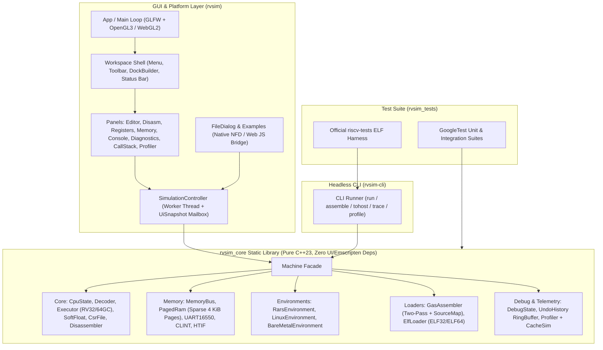

# `rvsim` Master Architecture & Checkpointed Implementation Roadmap

> **Status:** Checkpoints 0–3 complete (RV32I/RV64I core, assembler, `rvsim-cli`, and the interactive IDE on Native + Web). Next: Checkpoint 4. Check off items as each checkpoint lands and passes verification.
>
> **Implementation notes (Checkpoints 0–3):**
> - `ECALL`/`EBREAK` are returned by `Execute()` as `ExecStatus` values and dispatched by `Machine` to the `ExecutionEnvironment`, so `Execute()` takes no environment parameter. An ecall that needs console input returns `kWaitForInput` and is re-executed once input arrives.
> - Additional core files: `core/registers.h` (ABI names), `core/encoder.{h,cpp}` (range-checked encoding shared by the assembler and tests), and `env/buffered_console.{h,cpp}` (in-memory `ConsoleIo` used by the controller and tests).
> - `SimulationController` accepts both address breakpoints and source-line breakpoints; line breakpoints are remapped through the source map on every assembly so `Assemble` + `Run` issued together stop correctly.
> - In the assembler, integer-literal branch/jump targets are byte offsets, while symbolic targets are absolute addresses. `li` expansion reproduces GNU `as` `load_const` (verified against binutils 2.45).
> - The Checkpoint 3 browser checks ran against headless Chromium over the DevTools protocol, because the `chrome-devtools` MCP server requires Google Chrome at `/opt/google/chrome`.

## Table of Contents

1. [Overview & Agreed Product Scope](#1-overview--agreed-product-scope)
2. [Architectural Decisions & Layout Rationale](#2-architectural-decisions--layout-rationale)
3. [System Architecture & Target Directory Layout](#3-system-architecture--target-directory-layout)
4. [Checkpoint Progress Tracker (Checkpoints 0–10)](#4-checkpoint-progress-tracker-checkpoints-010)
5. [Detailed Checkpoint Specifications (Checkpoints 0–10)](#5-detailed-checkpoint-specifications-checkpoints-010)
6. [Cross-Platform Pitfalls & Guardrails](#6-cross-platform-pitfalls--guardrails)
7. [Standard Verification Commands](#7-standard-verification-commands)

---

## 1. Overview & Agreed Product Scope

Build **`rvsim`** into a cross-platform, spec-accurate **RV32GC / RV64GC** hybrid architectural simulator and interactive Dear ImGui debugger IDE in **C++23**, targeting **Linux, macOS, Windows, and WebAssembly (Emscripten)**.

`rvsim` supports both **built-in RISC-V assembly authoring** (via an in-process GNU `gas`-compatible single-file assembler) and **real compiled C/C++/Rust static ELF32/ELF64 binaries**, sharing a single headless, unit-testable simulator library (`rvsim_core`) across:

- **`rvsim`** — Interactive Dear ImGui + GLFW + OpenGL3/WebGL2 IDE (Native Desktop + WebAssembly).
- **`rvsim-cli`** — Standalone headless CLI runner for scripting, execution traces, profiling summaries, and automated `riscv-tests` ISA conformance in CI.
- **`rvsim_tests`** — GoogleTest/CTest unit and integration test suite with ASan/UBSan support.

| Dimension | Agreed Scope |
|---|---|
| **Vision** | Hybrid IDE + Architectural Simulator: spec-accurate RV32/RV64 functional core paired with an interactive Dear ImGui debugger |
| **ISA Profile** | Full **RV32GC & RV64GC** (`I`, `M`, `A`, `F`, `D`, `Zicsr`, `Zifencei`, `C`), built incrementally across checkpoints |
| **Execution Environments** | User-mode with pluggable syscall ABIs (**RARS/Venus** + **Linux/Newlib**) plus optional **M-mode bare-metal traps & MMIO** (`UART16550`, `CLINT`, `HTIF tohost`) |
| **Assembler & Inputs** | Built-in **GNU `gas`-compatible single-file assembler** (sections, directives, `.globl`/`.equ`, local labels `1f`/`1b`, `%hi`/`%lo`/`%pcrel_hi`/`%pcrel_lo`, full RISC-V pseudo-instructions, line-to-PC source map, structured diagnostics) + **ELF32/ELF64 static executable loader** + built-in example gallery |
| **Debugger & Engine** | Step In / Step Over / Step Out / **Step Back** (bounded undo ring buffer), Run / Pause / Reset, source & address breakpoints, memory watchpoints, adjustable speed (`1 Hz` to Max) on a dedicated worker thread |
| **IDE & Extras** | Core debugger panels (Editor, Disassembly, Registers/CSRs, Memory/Stack, Console & Diagnostics, Call Stack, Toolbar/Status Bar) + **Native/Web File I/O & Example Gallery** + **Headless CLI (`rvsim-cli`)** + **Execution Profiler & Cache Stats** |
| **Checkpoint Sequencing** | **Vertical-Slice First**: reach a live RV32I/RV64I assembly-to-UI debugging loop by Checkpoint 3, then iterate through ELF/Linux, `M`/`A`/`Zicsr`, `C`, `F`/`D`, M-mode/`riscv-tests`, Full Debugger/File I/O, and Profiling |
| **Verification & CI** | GoogleTest/CTest via CPM, Compiler Explorer golden instruction vectors, official `riscv-tests` ELF compliance suite via `rvsim-cli`, ASan/UBSan preset, GitHub Actions CI (`ctest` on Linux/macOS/Windows + Web build), and Chrome DevTools live UI checks |

---

## 2. Architectural Decisions & Layout Rationale

1. **Directory Layout & Header Policy (Colocated `.h` + `.cpp` under `src/`):**
   - **Keep `.h` and `.cpp` files colocated under `src/`** rather than splitting into parallel `include/` and `src/` trees.
   - `rvsim` is a self-contained multi-target application repository (`rvsim`, `rvsim-cli`, `rvsim_tests`) rather than an externally installed C++ SDK.
   - This matches the existing codebase (`src/app.{h,cpp}`, `src/windows/*`) and Google C++ Style, eliminates maintaining mirrored directory trees across 10 checkpoints of rapid refactoring, and keeps consistent `src/`-relative includes (for example, `#include "simulator/core/types.h"`, `#include "windows/editor_window.h"`).
   - A **hard compile-time wall around `rvsim_core`** is enforced via CMake target boundaries: `rvsim_core` does not link `imgui_lib`, `imgui_text_editor`, `glfw`, or Emscripten UI backends, so any accidental UI/GLFW/Emscripten include inside `src/simulator/` fails compilation immediately.
2. **No Exceptions Anywhere (`std::expected` / `std::optional`):**
   - Emscripten builds default to `-sDISABLE_EXCEPTION_CATCHING=1`. All fallible core APIs (`Decoder`, `MemoryBus`, `ElfLoader`, `Assembler`, `Machine`) avoid `throw`/`try`/`catch` and communicate errors via `std::expected<T, Error>` or `std::optional<T>`.
3. **Unified RV32 / RV64 Execution (`template <Xlen kXlen>`):**
   - `CpuState` stores `std::array<uint64_t, 32> x{}` and `uint64_t pc{}`.
   - In `Xlen::k32`, register writes mask to 32 bits (`val & 0xFFFFFFFFULL`) and `x0` is enforced as `0` after every commit. `Executor` dispatches through `template <Xlen kXlen>` with `UXlen` (`uint32_t` / `uint64_t`) and `SXlen` (`int32_t` / `int64_t`) for exact arithmetic, shift masks, wraparound, and `*W` sign-extension.
4. **Deterministic Software IEEE-754 Engine for `F`/`D` (Checkpoint 7):**
   - WebAssembly does not support runtime IEEE-754 rounding-mode switching (`fesetround`) or hardware FP exception flags (`fetestexcept`), and x86/ARM hardware lacks RISC-V's `RMM` (ties-to-max-magnitude) rounding mode.
   - Implementing a self-contained C++23 `SoftFloat` module guarantees bit-identical `RV32FD`/`RV64FD` results across Linux, macOS, Windows, and WebAssembly and passes `riscv-tests` `uf`/`ud`.
5. **Sparse 4 KiB Paged RAM (`PagedRam`):**
   - Backing RAM with sparse 4 KiB pages (`std::unordered_map<uint64_t, Page>` + a 4-entry direct-mapped page cache) handles arbitrary ELF virtual address layouts (`0x00010000`, `0x80000000`, `0x7ffffff0`, `0x0000003ffffff000`) cleanly within Emscripten's `-sMAXIMUM_MEMORY=1GB` budget.
6. **Single Serialized Worker Thread (`SimulationController`):**
   - Replaces the race-prone `Context::StartCompilation()` placeholder in [src/context.h](src/context.h) and [src/context.cpp](src/context.cpp).
   - Both assembly/ELF loading and execution run sequentially as commands on one portable `std::thread` + `std::mutex` + `std::condition_variable` (avoiding `std::jthread` libc++ portability gaps on Apple Clang), publishing throttled `UiSnapshot` copies (~60 Hz while running, immediate on step/pause/halt) and staying safely inside Emscripten's `-sPTHREAD_POOL_SIZE=2`.
7. **Zero-Allocation Undo History (`UndoHistory`):**
   - Each executed instruction appends one compact `InstructionDelta` (~48 bytes: `prev_pc`, modified GPR/FPR/CSR slot + previous 64-bit value, memory write addr + width + old 8 bytes, previous reservation/privilege state) into a pre-allocated ring buffer (default 65,536 entries, ~3.1 MB), toggleable off for max-speed profiling runs.
8. **Minimal New CPM Dependencies:**
   - **Checkpoint 0 (Native tests only):** `google/googletest` (`v1.17.0`), gated behind `RVSIM_BUILD_TESTS` (automatically `OFF` on Emscripten).
   - **Checkpoint 9 (Native desktop GUI only):** `btzy/nativefiledialog-extended` for OS-native file dialogs (Web uses `<input type="file">`, download blobs, and canvas drag-and-drop in [shell_minimal.html](shell_minimal.html)).
   - Profiler visualizations use built-in Dear ImGui tables (`ImGuiTableSortSpecs` + `ImGuiListClipper`) and styled draw-list bars—no ImPlot dependency required.

---

## 3. System Architecture & Target Directory Layout



### Target Repository Structure

```text
rvsim/
├── CMakeLists.txt                   # Targets: rvsim_core, rvsim_platform, rvsim, rvsim_cli, rvsim_tests
├── CMakePresets.json                # native-debug, native-release, native-asan, web, web-emcmake + testPresets
├── ROADMAP.md                       # This master architecture and checkpoint roadmap
├── src/
│   ├── simulator/                   # Compiled into rvsim_core (namespace rvsim)
│   │   ├── core/
│   │   │   ├── types.h              # Xlen, IsaExtensions, Trap, Error, StepOutcome, RegisterInfo
│   │   │   ├── cpu_state.h          # x[32], f[32], pc, priv_mode, reservation, cycle/instret
│   │   │   ├── csr_file.{h,cpp}     # CSR read/write/mask, fcsr, counters, M-mode CSRs
│   │   │   ├── instruction.h        # DecodedInst value struct & Opcode enum
│   │   │   ├── decode_cache.h       # Direct-mapped 4096-entry decoded instruction cache
│   │   │   ├── decoder.{h,cpp}      # 32-bit + 16-bit RVC instruction decoder
│   │   │   ├── disassembler.{h,cpp} # DecodedInst -> canonical RISC-V assembly text
│   │   │   ├── soft_float.{h,cpp}   # Deterministic IEEE-754 f32/f64 + 5 rounding modes + fflags
│   │   │   └── executor.{h,cpp}     # Templated <Xlen> execution engine (I, M, A, F, D, C, Zicsr, Zifencei)
│   │   ├── memory/
│   │   │   ├── memory_bus.{h,cpp}   # Address routing, MMIO dispatch, watchpoint hooks, alignment checks
│   │   │   ├── paged_ram.{h,cpp}    # Sparse 4 KiB pages + small direct-mapped page cache
│   │   │   ├── mmio_device.h        # MmioDevice interface
│   │   │   ├── uart_16550.{h,cpp}   # 16550A-compatible MMIO UART wired to Console I/O
│   │   │   ├── clint.{h,cpp}        # mtime, mtimecmp, msip timer & software interrupts
│   │   │   └── htif_device.{h,cpp}  # tohost / fromhost device for riscv-tests
│   │   ├── env/
│   │   │   ├── environment.h        # ExecutionEnvironment interface & ConsoleIo callbacks
│   │   │   ├── rars_env.{h,cpp}     # RARS/Venus ecall handler
│   │   │   ├── linux_env.{h,cpp}    # RISC-V Linux/Newlib user-mode syscall ABI & stack init
│   │   │   └── baremetal_env.{h,cpp}# Architectural M-mode trap/interrupt vectoring & mret
│   │   ├── loader/
│   │   │   ├── program_image.h      # Segments, entry, symbols, line<->PC SourceMap, XLEN, tohost
│   │   │   ├── elf_loader.{h,cpp}   # Zero-exception ELF32 & ELF64 EM_RISCV loader
│   │   │   ├── asm_lexer.{h,cpp}    # Token stream with file/line/col spans
│   │   │   ├── asm_pseudo.{h,cpp}   # Standard RISC-V pseudo-instruction expansion
│   │   │   └── assembler.{h,cpp}    # Two-pass GNU gas-compatible assembler + relocations + diagnostics
│   │   ├── debug/
│   │   │   ├── debug_state.{h,cpp}  # PC breakpoints, R/W watchpoints, call-stack tracker
│   │   │   ├── undo_history.{h,cpp} # Fixed-capacity flat ring buffer of InstructionDelta (~48 B/step)
│   │   │   └── profiler.{h,cpp}     # Opcode histogram, hotspots, branch stats, optional L1I/L1D cache sim
│   │   └── runtime/
│   │       ├── machine.{h,cpp}      # Synchronous Machine facade (Load, Reset, Step, StepBack, Run)
│   │       └── controller.{h,cpp}   # Thread-safe SimulationController (worker thread + UiSnapshot mailbox)
│   ├── cli/
│   │   └── main.cpp                 # rvsim-cli entrypoint (native-only)
│   ├── platform/
│   │   ├── file_dialog.{h,cpp}      # Native NFD / Web JS file picker, download & drag-and-drop bridge
│   │   └── examples.{h,cpp}         # Built-in RV32 & RV64 example assembly programs
│   ├── ui/
│   │   ├── design_tokens.h          # Centralized theme tokens, WCAG colors, spacing, Dark/Light presets
│   │   ├── riscv_language.{h,cpp}   # Custom TextEditor::Language definition for RISC-V assembly
│   │   └── workspace.{h,cpp}        # Menu bar, Execution toolbar, DockBuilder layout, Status bar, shortcuts
│   ├── windows/                     # Panel classes inheriting rvsim::Window
│   │   ├── window.{h,cpp}
│   │   ├── editor_window.{h,cpp}    # Renamed from src/windows/editor.cpp for consistency
│   │   ├── disassembly_window.{h,cpp}
│   │   ├── register_window.{h,cpp}
│   │   ├── memory_window.{h,cpp}
│   │   ├── console_window.{h,cpp}   # Replaces OutputWindow with Console I/O + Diagnostics tabs
│   │   ├── callstack_window.{h,cpp}
│   │   ├── profiler_window.{h,cpp}
│   │   └── demo_window.{h,cpp}
│   ├── app.{h,cpp}
│   ├── context.{h,cpp}
│   └── main.cpp
└── tests/
    ├── unit/                        # Per-component GoogleTest unit tests
    ├── integration/                 # End-to-end assembly, ELF, syscall, & riscv-tests harnesses
    └── testdata/                    # Assembly fixtures & minimal compiled ELF test vectors
```

---

## 4. Checkpoint Progress Tracker (Checkpoints 0–10)

| Status | CP | Title | Key Deliverable | Primary Verification Gate |
|---|---|---|---|---|
| `[x]` | **0** | Build System, `rvsim_core` Split, Testing & CI | `rvsim_core`, `rvsim_tests`, `rvsim-cli` stub, `native-asan` preset, CI `ctest` | All 4 presets build + `ctest` + ASan green |
| `[x]` | **1** | Core Machine, Sparse RAM & RV32I/RV64I Engine | `CpuState`, `PagedRam`, `MemoryBus`, RV32I/64I decode/exec/disasm, RARS env | Unit tests for all I instructions vs Compiler Explorer encodings |
| `[x]` | **2** | GNU `gas` Assembler (Base I) & Working `rvsim-cli` | Two-pass assembler, directives, pseudos, source map, diagnostics, CLI runner | Assemble & run multi-function RV32I/RV64I `.s` programs |
| `[x]` | **3** | **First Interactive IDE Vertical Slice** | Thread-safe `SimulationController`, full ImGui workspace, Editor/Regs/Mem/Disasm/Console | Write, assemble, step, debug RV32I/RV64I in Native & Web (Chrome DevTools) |
| `[ ]` | **4** | ELF32/ELF64 Loader & Linux/Newlib Syscalls | Bounds-checked ELF loader, symbol table, Linux/Newlib `ecall` ABI, stack init | Run real GCC/Clang-compiled RV32I/RV64I C ELF binaries in CLI & IDE |
| `[ ]` | **5** | `M`, `A`, `Zicsr` & `Zifencei` Extensions | Mul/Div/Rem, `lr`/`sc` + AMOs, `CsrFile`, CSR instructions, CSR UI tab | Unit tests (div edge cases, LR/SC invalidation, CSR RO/RW) + ELF tests |
| `[ ]` | **6** | `C` (16-bit Compressed) & Decode Cache | RV32C/RV64C decoder/expander, 2-byte alignment, Disasm & Asm support, decode cache | Compressed ELFs (`-march=rv{32,64}imac`) + mixed 16/32-bit stepping |
| `[ ]` | **7** | `F` & `D` Extensions (Deterministic `SoftFloat`) | Cross-platform IEEE-754 `SoftFloat`, NaN-boxing, all `F`/`D`/`C.F*` ops, Float UI tab | IEEE-754 edge cases (5 rounding modes, `fflags`, FMA, NaN-box) Native == Web |
| `[ ]` | **8** | M-Mode Traps, MMIO (`UART`/`CLINT`/`HTIF`) & `riscv-tests` | M-mode CSRs & traps, `mret`, `UART16550`, `CLINT`, `HTIF`, official `riscv-tests` in CI | Official `rv{32,64}u{i,m,a,f,d,c}-p-*` suites passing 100% in CTest & CI |
| `[ ]` | **9** | Full Debugger (Step-Back/Over/Out/Watchpoints) + File I/O & Examples | Undo ring buffer, Call Stack panel, Watchpoints, Native/Web Open/Save/Drop, Example Gallery | Step-back round-trip invariants, Native + Web file drag-and-drop & examples |
| `[ ]` | **10** | Execution Profiler, Cache Simulator & UI/UX Release Polish | Opcode/hotspot/branch profiler, L1I/L1D cache sim, Dark/Light themes, UI audit, release packaging | Profiler accuracy tests, ImGui quality audit, Chrome DevTools & full CI matrix |

---

## 5. Detailed Checkpoint Specifications (Checkpoints 0–10)

### Checkpoint 0: Build System, `rvsim_core` Library Split, Testing & CI Foundation

**Objective:** Establish the decoupled target graph, host unit-testing infrastructure, sanitizer preset, and CI test gates before writing simulator logic.

- [x] **Refactor [CMakeLists.txt](CMakeLists.txt) to explicit, target-scoped source lists:**
  - `rvsim_core` (`STATIC`): pure C++23 simulator sources in `src/simulator/` with `-Wall -Wextra` (`/W4` on MSVC), zero ImGui/GLFW/Emscripten dependencies.
  - `rvsim` (GUI executable): links `rvsim_core`, `imgui_lib`, `imgui_text_editor`, `rvsim_platform`.
  - `rvsim-cli` (Native-only executable, `if(NOT EMSCRIPTEN)`): `src/cli/main.cpp`, links `rvsim_core`.
  - `rvsim_tests` (Native-only, `option(RVSIM_BUILD_TESTS "Build unit tests" ON)` when `NOT EMSCRIPTEN`): fetches `google/googletest` (`v1.17.0`) via `CPMAddPackage`, uses `enable_testing()`, `include(GoogleTest)`, and `gtest_discover_tests(rvsim_tests)`.
  - Add `option(RVSIM_ENABLE_SANITIZERS "Enable ASan + UBSan" OFF)` applying `-fsanitize=address,undefined -fno-omit-frame-pointer` on GCC/Clang native builds.
  - Rename [src/windows/editor.cpp](src/windows/editor.cpp) to `src/windows/editor_window.cpp` for filename consistency with [src/windows/editor_window.h](src/windows/editor_window.h).
- [x] **Update [CMakePresets.json](CMakePresets.json):**
  - Add `native-asan` configure and build preset (`Debug` + `RVSIM_ENABLE_SANITIZERS=ON`).
  - Add `testPresets` for `native-debug`, `native-release`, and `native-asan`.
- [x] **Update [.github/workflows/ci.yml](.github/workflows/ci.yml):**
  - Run `ctest --preset native-release --output-on-failure` on Linux, Windows, and macOS jobs.
  - Add a Linux `native-asan` build + `ctest` step to catch memory/UB regressions on every push and PR.
- [x] **Create core namespace & stub targets:**
  - Create `src/simulator/core/types.h` (`Xlen`, `IsaExtensions`, `Error`, `std::expected` helpers).
  - Align [src/simulator/simulator.h](src/simulator/simulator.h) and [src/simulator/simulator.cpp](src/simulator/simulator.cpp) into `namespace rvsim`.
  - Create minimal `src/cli/main.cpp` and `tests/unit/smoke_test.cpp` verifying `rvsim_core` links and executes cleanly.

**Exit Criteria:**
- `native-debug`, `native-release`, `native-asan`, and `web-emcmake` all build with zero warnings.
- `ctest` passes on all native presets and `rvsim_core` contains zero UI/Emscripten headers.

---

### Checkpoint 1: Core Machine Model, Sparse Memory & RV32I / RV64I Execution Engine

**Objective:** Implement the foundational CPU state, sparse 4 KiB paged memory bus, complete RV32I + RV64I decoder/executor/disassembler, and RARS/Venus user-mode `ecall` environment.

- [x] **CPU State (`src/simulator/core/cpu_state.h`):**
  - `CpuState`: `Xlen xlen`, `IsaExtensions extensions`, `std::array<uint64_t, 32> x`, `std::array<uint64_t, 32> f`, `uint64_t pc`, `PrivilegeMode priv`, `uint64_t cycle`, `uint64_t instret`, and reservation state placeholder.
  - Helpers `ReadReg(uint8_t idx)` and `WriteReg(uint8_t idx, uint64_t val)` enforcing `x0 == 0` and 32-bit masking in `Xlen::k32`.
- [x] **Sparse Memory (`src/simulator/memory/paged_ram.{h,cpp}`, `mmio_device.h`, `memory_bus.{h,cpp}`):**
  - Sparse 4 KiB page storage (`kPageSize = 4096`) with 4-entry direct-mapped lookup cache, bulk `WriteRegion()` / `ReadRegion()`, and page enumeration API for the Memory Inspector.
  - Little-endian `Read8/16/32/64` & `Write8/16/32/64` returning `std::expected<T, Trap>`, plus configurable alignment policy (`strict_alignment`: `false` by default for user-mode compatibility, `true` when strict traps are requested).
- [x] **Decode & Disassemble (`src/simulator/core/instruction.h`, `decoder.{h,cpp}`, `disassembler.{h,cpp}`):**
  - Full RV32I (40 instructions) + RV64I (+12: `LWU`, `LD`, `SD`, `ADDIW`, `SLLIW`, `SRLIW`, `SRAIW`, `ADDW`, `SUBW`, `SLLW`, `SRLW`, `SRAW`): `LUI`, `AUIPC`, `JAL`, `JALR`, `BEQ`–`BGEU`, `LB`–`LHU`/`LWU`/`LD`, `SB`–`SW`/`SD`, `ADDI`–`SRAI`, `ADD`–`AND`, `FENCE`, `ECALL`, `EBREAK`.
  - Canonical disassembler consuming `DecodedInst` and formatting ABI names (configurable numeric `xN` vs ABI `a0`/`sp`/`ra`).
- [x] **Execution Engine (`src/simulator/core/executor.{h,cpp}`):**
  - `template <Xlen kXlen> StepOutcome Execute(CpuState&, MemoryBus&, const DecodedInst&, ExecutionEnvironment&)`.
  - Exact RISC-V semantics: `JALR` clears bit 0 of target address; RV32 shift amounts use `rs2 & 0x1F`, RV64 uses `rs2 & 0x3F`, and `*W` instructions mask shift amounts with `0x1F` and sign-extend 32-bit results to 64 bits.
- [x] **RARS/Venus Environment & Machine Facade (`src/simulator/env/environment.h`, `rars_env.{h,cpp}`, `src/simulator/runtime/machine.{h,cpp}`):**
  - `ConsoleIo` interface (`WriteStdout`, `WriteStderr`, `ReadLine`, `ReadChar`, `NeedsInput` state so interactive console stdin never deadlocks the UI).
  - RARS/Venus `ecall` codes in `a7`: `1` PrintInt, `4` PrintString, `5` ReadInt, `8` ReadString, `9` Sbrk, `10` Exit, `11` PrintChar, `12` ReadChar, `34` PrintHex, `35` PrintBin, `36` PrintUnsigned, `93` Exit2.
  - Synchronous `Machine` tying `CpuState`, `MemoryBus`, `ExecutionEnvironment`, `Step()`, `Run(max_steps)`, and `Reset()`.
- [x] **Unit Tests:**
  - `tests/unit/memory_test.cpp`, `tests/unit/decoder_i_test.cpp`, `tests/unit/executor_i_test.cpp`, `tests/unit/rars_env_test.cpp` verified against Compiler Explorer (`riscv32`/`riscv64` GCC/Clang) golden encodings, boundary arithmetic (`INT32_MIN`, `INT64_MIN`, unsigned wraparound, negative branch offsets, `x0` immutability), and RARS syscall round-trips.

**Exit Criteria:**
- `ctest --preset native-asan --output-on-failure` passes 100% of memory, decode, disasm, RV32I/RV64I execution, and RARS syscall tests with zero sanitizer findings.

---

### Checkpoint 2: Built-in GNU `gas` Assembler (Base I) & Functional `rvsim-cli`

**Objective:** Build the two-pass GNU `gas`-compatible single-file assembler with rich source-line mapping and diagnostics, and wire `rvsim-cli` to assemble and execute `.s` programs end-to-end.

- [x] **Program Image (`src/simulator/loader/program_image.h`):**
  - `ProgramImage`: `Xlen xlen`, `uint64_t entry_point`, `uint64_t initial_gp`, `uint64_t initial_sp`, `std::vector<Segment>` (`.text`, `.rodata`, `.data`, `.bss`), bidirectional symbol table (`name -> address`, `address -> symbol`), `SourceMap` (`pc <-> line_number`), optional `tohost_addr`.
  - `Diagnostic` struct: `Severity` (`Error`/`Warning`), `int line` (1-based), `int column`, `std::string message`.
- [x] **Lexer & Pseudo-Instruction Expander (`src/simulator/loader/asm_lexer.{h,cpp}`, `asm_pseudo.{h,cpp}`):**
  - Tokenize labels, local numeric labels (`1:`, `1f`, `1b`), directives, registers (`x0`–`x31`, `zero`–`t6`, `fp`), numeric/char literals (decimal, `0x`, `0b`, `0o`, `'a'`, constant arithmetic `+`/`-`/`*`/`/`/`<<`/`>>`/`|`/`&`), escaped strings, relocation modifiers (`%hi(...)`, `%lo(...)`, `%pcrel_hi(...)`, `%pcrel_lo(...)`), and `#` / `//` / `/* */` comments.
  - Expand standard base pseudo-instructions: `nop`, `li` (full 32-bit and 64-bit expansion for RV32 vs RV64), `la`, `mv`, `not`, `neg`, `negw`, `sext.w`, `seqz`, `snez`, `sltz`, `sgtz`, `beqz`, `bnez`, `blez`, `bgez`, `bltz`, `bgtz`, `bgt`, `ble`, `bgtu`, `bleu`, `j`, `jal offset` (implicit `ra`), `jr`, `jalr rs` (implicit `ra`), `ret`, `call`, `tail`.
- [x] **Two-Pass Assembler (`src/simulator/loader/assembler.{h,cpp}`):**
  - **Pass 1:** Track active section (`.text`, `.data`, `.rodata`, `.bss`), process `.equ`/`.set`, `.globl`/`.global`, `.align`/`.balign`/`.p2align`, `.byte`/`.half`/`.word`/`.dword`/`.ascii`/`.asciz`/`.string`/`.zero`/`.space`, record symbol addresses and local numeric label instances, and compute exact instruction/pseudo byte sizes & source-line associations.
  - **Pass 2:** Lay out sections into default memory regions (`.text` @ `0x00400000`, `.rodata` + `.data` + `.bss` @ `0x10000000` in user-mode, or configurable base addresses), resolve symbols, local `1f`/`1b` labels, and `%hi`/`%lo`/`%pcrel_hi`/`%pcrel_lo`, validate immediate ranges, emit machine code, and collect **all** diagnostics (recovering across lines instead of aborting on the first syntax error).
- [x] **Working CLI (`src/cli/main.cpp`):**
  - Implement `rvsim-cli run <file.s>` and `rvsim-cli assemble <file.s> --disasm` with flags `--arch rv32i|rv64i`, `--env rars`, `--max-steps N`, `--dump-regs`, `--trace`.
- [x] **Tests (`tests/unit/assembler_test.cpp`, `tests/integration/asm_programs_test.cpp`):**
  - Bit-for-bit comparison against Compiler Explorer (`riscv32`/`riscv64` GNU `as`) output for every base instruction, pseudo-instruction, relocation, and local label pattern.
  - End-to-end execution of recursive factorial, Fibonacci, quicksort over `.data` array, and string I/O via RARS `ecall`.

**Exit Criteria:**
- `ctest --preset native-asan --output-on-failure` passes all assembler unit tests and end-to-end assembly integration tests.
- Running `./build/native-release/rvsim-cli run tests/testdata/fibonacci.s --dump-regs` prints expected output and exits `0`.

---

### Checkpoint 3: First Interactive IDE Vertical Slice (Native + Web)

**Objective:** Deliver the first end-to-end interactive IDE experience: write RV32I/RV64I assembly, assemble (`Ctrl+B`), see syntax highlighting & inline error markers, set breakpoints, step/run on a worker thread, and inspect Registers, Disassembly, Memory/Stack, and Console I/O live on Desktop and WebAssembly.

- [x] **Thread-Safe Controller (`src/simulator/runtime/controller.{h,cpp}`):**
  - `SimulationController` owns a `Machine` on one dedicated `std::thread` with command queue (`std::mutex` + `std::condition_variable`) for `Assemble`, `Run`, `Pause`, `StepIn`, `Reset`, `SetBreakpoints`, `SetSpeedHz`, `SendConsoleInput`, `WriteRegister`, `WriteMemory`, and `SetConfig`.
  - Throttled `UiSnapshot` publisher (~60 Hz while `Running`, immediate on `Step`/`Pause`/`Halt`/`WaitingForInput`/`Error`) carrying `CpuState`, previous register snapshot (for changed-value highlighting), run state, stop reason, diagnostics, symbols, source map, console buffer, and requested memory viewport slice.
  - Clean RAII shutdown joining the worker thread in destructor (safe on both Native and Emscripten).
- [x] **UI Design System & Workspace Shell (`src/ui/`):**
  - `design_tokens.h`: centralized colors, spacing scale, typography helpers, and semantic tokens (WCAG ≥ 4.5:1 text contrast): active PC highlight, breakpoint gutter dot, changed register accent, error/warning/info badges, running/paused/halted pills.
  - `riscv_language.{h,cpp}`: custom `TextEditor::Language` highlighting RISC-V mnemonics, ABI/numeric registers, assembler directives, numbers/hex literals, strings, labels, and `#`/`//` comments.
  - `workspace.{h,cpp}`: Menu Bar (`File`, `Edit`, `View`, `Simulate`, `Help`), Execution Toolbar (`RV32`/`RV64` selector, Environment selector, `Assemble`, `Run`/`Pause`, `Step`, `Reset`, Speed slider), first-run `DockBuilder` default layout + `View → Reset Layout`, Bottom Status Bar (state, arch, PC, cycle/instret, effective Hz/MIPS), and keyboard shortcuts (`F5`, `F11`, `F9`, `Ctrl+B`, `Ctrl+R`) respecting `io.WantTextInput`.
- [x] **Wire Context, App & Panels (`src/context.{h,cpp}`, `src/app.{h,cpp}`, `src/main.cpp`, `src/windows/`):**
  - Remove the unsafe placeholder `StartCompilation()` worker in [src/context.cpp](src/context.cpp); connect [src/context.h](src/context.h) to `SimulationController` and poll one frame-consistent `UiSnapshot` per frame in [src/app.cpp](src/app.cpp).
  - Hide [src/windows/demo_window.h](src/windows/demo_window.h) behind `Help → Dear ImGui Demo`.
  - Upgrade `EditorWindow`: RISC-V syntax highlighting, clickable breakpoint gutter & current-PC arrow (`TextEditor::SetLineDecorator`), assembler error tooltips (`TextEditor::AddMarker`), read-only lock while running, and dirty indicator when edited after assemble.
  - Add `DisassemblyWindow`: `ImGuiListClipper`-virtualized instruction list with breakpoint dot, PC arrow, address, raw hex encoding, symbol headers, disassembled mnemonic/operands, and follow-PC toggle.
  - Add `RegisterWindow`: `Int (x0–x31)` tab (`Float` & `CSRs` placeholders ready for Checkpoints 5 & 7), Hex / Signed / Unsigned toggle, modified-register highlight, and double-click inline editing when paused.
  - Add `MemoryWindow`: `ImGuiListClipper` hex + ASCII inspector over `PagedRam`, quick-jump buttons (`PC`, `SP`, `GP`, `.text`, `.data`, symbol dropdown, hex input), `Byte`/`Half`/`Word`/`DWord` grouping, changed-byte highlighting, and a dedicated **Stack View** tab anchored at `sp`.
  - Add `ConsoleWindow` (replacing [src/windows/output_window.h](src/windows/output_window.h) / [src/windows/output_window.cpp](src/windows/output_window.cpp)): **Console I/O** tab (stdout/stderr + stdin input box + clear/copy) and **Diagnostics** tab (clickable assembler/loader errors jumping directly to exact line/column in `EditorWindow`).

**Exit Criteria:**
- Native builds (`native-debug`, `native-release`, `native-asan`) + `ctest` green; controller thread-safety test passes under ASan/UBSan.
- Web build (`emcmake cmake --preset web-emcmake && cmake --build --preset web-emcmake`) succeeds cleanly.
- `emrun --no_browser --port 8080 build/web/index.html` verified via **Chrome DevTools**: zero console/WebGL/COI errors, panels render cleanly at 1280×800 and narrow sizes, and assembling/stepping RV32I/RV64I programs updates all panels live.
- `.agents/skills/imgui-ui-ux-engineering/scripts/check_imgui_cpp.py` passes with balanced `Begin`/`End` and `Push`/`Pop`.

---

### Checkpoint 4: ELF32 & ELF64 Loader + Linux / Newlib User-Mode Syscalls

**Objective:** Enable loading and executing real GCC/Clang/Rust-compiled static RISC-V ELF32 and ELF64 binaries, complete with symbol tables and Linux/Newlib user-mode syscalls.

- [ ] **`ElfLoader` (`src/simulator/loader/elf_loader.{h,cpp}`):**
  - Strictly bounds-checked, zero-exception ELF32 & ELF64 parser operating on `std::span<const uint8_t>` (works identically for native disk buffers and browser-uploaded byte arrays).
  - Validates magic (`\x7fELF`), `ELFCLASS32` / `ELFCLASS64`, `ELFDATA2LSB`, `EM_RISCV` (`243`), `ET_EXEC` (and static `ET_DYN` PIE with fixed load bias).
  - Loads every `PT_LOAD` segment (`p_filesz` copied, `p_memsz - p_filesz` zero-filled for `.bss`); rejects dynamic `PT_INTERP` binaries with a clear diagnostic explaining static linking (`-static`).
  - Parses `.symtab` + `.strtab` (via `.shstrtab`) into `ProgramImage::symbols`, detects `tohost`, `fromhost`, and `__global_pointer$` automatically, and inspects RISC-V `e_flags` (`EF_RISCV_RVC`, `EF_RISCV_FLOAT_ABI_*`) to auto-select `Xlen`.
- [ ] **`LinuxEnvironment` (`src/simulator/env/linux_env.{h,cpp}`):**
  - Standard RISC-V Linux / Newlib user-mode `ecall` ABI (`a7` = syscall, `a0`–`a5` = args, `a0` = return / `-errno`): `read` (`63`), `write` (`64`), `writev` (`66`), `close` (`57`), `lseek` (`62`), `fstat` (`80`), `exit` (`93`), `exit_group` (`94`), `set_tid_address` (`96`), `clock_gettime` (`113`), `uname` (`160`), `gettimeofday` (`169`), `getpid` (`172`), `getuid`/`geteuid`/`getgid`/`getegid` (`174`–`177`), `brk` (`214`), `munmap` (`215`), `mmap` (`222` anonymous private bump allocator), `ioctl` (`29` minimal tty stub for `isatty`), and safe sandboxed `faccessat`/`openat` stubs (`-ENOENT`).
  - psABI 16-byte-aligned process startup stack builder (`argc`, `argv`, `NULL`, `envp`, and `auxv` with `AT_PAGESZ`, `AT_PHDR`, `AT_PHENT`, `AT_PHNUM`, `AT_ENTRY`, `AT_RANDOM`, `AT_NULL`).
- [ ] **CLI & IDE Integration:**
  - Auto-detect ELF vs assembly input by `\x7fELF` magic in `rvsim-cli` and `SimulationController::LoadElf()`.
  - Add ELF symbol labels, section boundaries, and symbol search/jump to `DisassemblyWindow`.
- [ ] **Tests (`tests/unit/elf_loader_test.cpp`, `tests/integration/linux_elf_test.cpp`):**
  - Malformed, truncated, wrong-arch, and dynamic ELF rejection tests under ASan.
  - End-to-end execution of real compiled RV32I and RV64I static ELF binaries (`write`, `brk` heap allocation, exit codes).

**Exit Criteria:**
- `ctest --preset native-asan --output-on-failure` passes all ELF loader edge cases and real RV32I/RV64I ELF execution tests.
- `rvsim-cli run <sample.elf>` runs real compiled ELF binaries and propagates exit status accurately.

---

### Checkpoint 5: `M` (Multiply/Divide), `A` (Atomics), `Zicsr` & `Zifencei` Extensions

**Objective:** Expand the ISA, assembler, disassembler, and UI to full **RV32IMA + Zicsr + Zifencei** and **RV64IMA + Zicsr + Zifencei**.

- [ ] **`CsrFile` (`src/simulator/core/csr_file.{h,cpp}`):**
  - Architectural CSR storage with privilege and read-only (`csr[11:10] == 0b11` raises `IllegalInstruction`) validation.
  - User counters (`cycle`/`time`/`instret` `0xC00`–`0xC02` + RV32 upper halves `0xC80`–`0xC82`) and floating-point CSRs (`fflags` `0x001`, `frm` `0x002`, `fcsr` `0x003`), extensible for M-mode CSRs in Checkpoint 8.
- [ ] **ISA Decode & Execute (`decoder.{h,cpp}`, `executor.{h,cpp}`, `disassembler.{h,cpp}`):**
  - **`M` Extension:** `MUL`, `MULH`, `MULHSU`, `MULHU`, `DIV`, `DIVU`, `REM`, `REMU` + RV64 `MULW`, `DIVW`, `DIVUW`, `REMW`, `REMUW` with exact RISC-V div-by-zero and `INT_MIN / -1` semantics (zero C++ UB!) and portable 128-bit multiply (`__int128` on GCC/Clang/Emscripten + `_mul128`/`_umul128` or portable 64×64 helper on MSVC).
  - **`A` Extension:** `LR.W`/`SC.W`/`LR.D`/`SC.D` (reservation address + validity in `CpuState`, invalidated on conflicting store, `SC`, or trap) + `AMOSWAP`, `AMOADD`, `AMOXOR`, `AMOAND`, `AMOOR`, `AMOMIN`, `AMOMAX`, `AMOMINU`, `AMOMAXU` (`.W` & `.D`) with 4B/8B alignment checks.
  - **`Zicsr` & `Zifencei`:** `CSRRW`, `CSRRS`, `CSRRC`, `CSRRWI`, `CSRRSI`, `CSRRCI` (exact side-effect suppression on `rs1 == x0`/`uimm == 0` and `rd == x0` on `CSRRW`), plus `FENCE.I`.
- [ ] **Assembler, Syntax & UI:**
  - Add `M`, `A` (including `.aq`, `.rl`, `.aqrl` suffixes and `(rs1)` syntax), `Zicsr` (including `csrr`/`csrw`/`csrs`/`csrc`/`csrwi`/`csrsi`/`csrci`/`rdcycle`/`rdtime`/`rdinstret` and named CSR symbols), and `fence.i` to `Assembler` and `riscv_language.cpp`.
  - Enable the **CSRs** tab in `RegisterWindow` with decoded bitfield tooltips.
- [ ] **Tests (`tests/unit/ext_m_test.cpp`, `tests/unit/ext_a_test.cpp`, `tests/unit/ext_zicsr_test.cpp`):**
  - Upper multiply signs, division-by-zero & `INT_MIN / -1`, LR/SC hit/miss/invalidation, signed/unsigned AMO min/max, CSR read-only traps, and Godbolt encoding checks.

**Exit Criteria:**
- `ctest --preset native-asan --output-on-failure` passes all `I`/`M`/`A`/`Zicsr` tests on Linux/macOS/Windows (including MSVC `/W4` portable 128-bit mul).
- Native + Web builds clean with zero warnings.

---

### Checkpoint 6: `C` (16-bit Compressed) Extension & Decoded Instruction Cache

**Objective:** Support 16-bit compressed instructions (RV32C / RV64C) across fetch, decode, execution, disassembly, and assembly—unlocking standard `-march=rv32imac` / `-march=rv64imac` binaries—plus a lightweight decode cache.

- [ ] **Variable-Length Fetch & RVC Decoder (`decoder.{h,cpp}`, `instruction.h`):**
  - Fetch 16-bit halfword first; if `(raw16 & 0x3) != 0x3`, decode as a 2-byte RVC instruction (`DecodedInst::length = 2`, `is_compressed = true`).
  - Implement all three RVC quadrants (`00`, `01`, `10`) for RV32C and RV64C (XLEN-dependent `C.JAL` vs `C.ADDIW`, `C.FLW`/`C.FSW` vs `C.LD`/`C.SD`, `C.ADDI16SP`, `C.LUI`, `C.SLLI`, `C.JR`, `C.MV`, `C.EBREAK`, `C.JALR`, `C.ADD`, reserved `nzimm == 0` traps, and HINTs as `NOP`).
- [ ] **Alignment & Decode Cache (`executor.{h,cpp}`, `src/simulator/core/decode_cache.h`):**
  - Advance `pc += inst.length` (2 or 4); enforce `IALIGN = 16` when `C` is enabled vs `IALIGN = 32` when disabled (`InstructionAddressMisaligned` trap on misaligned branch/jump target).
  - Direct-mapped 4096-entry `DecodeCache` keyed by `(pc, xlen, ext_mask)`, invalidated on `FENCE.I`, program load, or writes to executable pages.
- [ ] **Assembler & Disassembly UI:**
  - Support explicit `c.*` instructions and optional auto-compression toggle in `Assembler`.
  - Walk variable-length 2/4-byte streams cleanly in `DisassemblyWindow` showing 4-hex-digit (`0x4501`) vs 8-hex-digit (`0x00100513`) encodings.
- [ ] **Tests (`tests/unit/ext_c_test.cpp`):**
  - Verify RV32C and RV64C encodings against Compiler Explorer (`-march=rv32imac` / `-march=rv64imac`), mixed 16/32-bit PC stepping, reserved-encoding traps, and decode-cache invalidation on self-modifying code + `fence.i`.

**Exit Criteria:**
- `ctest --preset native-asan --output-on-failure` passes all RVC and decode-cache tests.
- Running a real GCC/Clang `-march=rv64imac` compiled ELF steps seamlessly across 16-bit and 32-bit instructions in CLI and IDE Disassembly.

---

### Checkpoint 7: `F` & `D` Extensions (Deterministic Cross-Platform IEEE-754 `SoftFloat`)

**Objective:** Complete the full **RV32GC / RV64GC** ISA with single- and double-precision IEEE-754 floating-point instructions via a deterministic software floating-point engine identical across Linux, macOS, Windows, and WebAssembly.

- [ ] **Deterministic `SoftFloat` Engine (`src/simulator/core/soft_float.{h,cpp}`):**
  - Pure C++23 IEEE-754 bit-level arithmetic for `uint32_t` (`F32`) and `uint64_t` (`F64`) with explicit `RoundingMode` (`RNE`, `RTZ`, `RDN`, `RUP`, `RMM`) and `FpFlags` (`NV`, `DZ`, `OF`, `UF`, `NX`).
  - Operations: `Add`, `Sub`, `Mul`, `Div`, `Sqrt`, single-rounding `Fma` (`a * b + c`), `Min`/`Max` (RISC-V spec 2.2: `-0.0 < +0.0`, canonical NaN if both NaN, non-NaN if one NaN, sNaN sets `NV`), `Eq`, `Lt`, `Le`, `Classify`, `F32ToF64`, `F64ToF32`, `IntToF32/F64` (`i32`, `u32`, `i64`, `u64`), and `F32/F64ToInt` (RISC-V saturation on out-of-range/NaN).
  - Strict NaN-boxing helpers: `BoxF32(uint32_t)` (upper 32 bits = `0xFFFFFFFF`) and `UnboxF32(uint64_t)` (returns canonical `0x7FC00000` if upper 32 bits ≠ `0xFFFFFFFF` when `D` is enabled).
- [ ] **ISA Decode & Execute (`decoder.{h,cpp}`, `executor.{h,cpp}`, `disassembler.{h,cpp}`):**
  - All `F` & `D` instructions: `FLW`/`FSW`/`FLD`/`FSD` (plus compressed `C.FLW`/`C.FSW`/`C.FLWSP`/`C.FSWSP`/`C.FLD`/`C.FSD`/`C.FLDSP`/`C.FSDSP`), `FMADD`/`FMSUB`/`FNMSUB`/`FNMADD` (`.S`/`.D`), `FADD`/`FSUB`/`FMUL`/`FDIV`/`FSQRT`, `FSGNJ`/`FSGNJN`/`FSGNJX`, `FMIN`/`FMAX`, `FCVT.*`, `FMV.X.W`/`FMV.W.X`/`FMV.X.D`/`FMV.D.X`, `FEQ`/`FLT`/`FLE`, and `FCLASS`.
  - Resolve dynamic rounding mode `rm == 0b111` from `fcsr.frm`, trap `IllegalInstruction` on reserved `rm` (`5`, `6`) or invalid `frm`, and accumulate `fflags` into `fcsr`.
- [ ] **Assembler, Syntax & UI:**
  - Support all `F`/`D` mnemonics, rounding mode suffixes (`rne`, `rtz`, `rdn`, `rup`, `rmm`, `dyn`), pseudos (`fmv.s`, `fabs.s`, `fneg.s`, `fmv.d`, `fabs.d`, `fneg.d`), `.float`/`.double` directives, and `f0`–`f31` / `ft0`–`fa7` register aliases.
  - Enable the **Float (`f0–f31`)** tab in `RegisterWindow` showing raw 64-bit hex, `float` (unboxed + NaN-box badge), `double`, `fcsr` (`frm` selector + `NV`/`DZ`/`OF`/`UF`/`NX` flags), changed-register highlighting, and inline editing.
- [ ] **Tests (`tests/unit/soft_float_test.cpp`, `tests/unit/ext_fd_test.cpp`):**
  - Subnormals, signed zeros, `±inf`, sNaN vs qNaN propagation, NaN-boxing failures, all 5 rounding modes including `RMM`, single-rounding FMA cancellation, and conversion saturation.

**Exit Criteria:**
- `ctest --preset native-asan --output-on-failure` passes all `SoftFloat` and `F`/`D` unit tests.
- Running a real `-march=rv64gc` floating-point ELF produces bit-identical output on Native Linux/macOS/Windows and WebAssembly.

---

### Checkpoint 8: M-Mode Bare-Metal Traps, MMIO (`UART`, `CLINT`, `HTIF`) & Official `riscv-tests`

**Objective:** Implement Machine-mode privileged CSRs, architectural traps/interrupts, bare-metal MMIO peripherals (`UART16550`, `CLINT`, `HTIF`), and integrate the official **`riscv-tests`** ISA conformance suite into CTest and GitHub Actions CI.

- [ ] **Privileged M-Mode CSRs & Environment (`csr_file.{h,cpp}`, `src/simulator/env/baremetal_env.{h,cpp}`):**
  - CSRs: `mvendorid`, `marchid`, `mimpid`, `mhartid`, `misa` (reflecting active XLEN + `IMAFDC`), `mstatus`/`mstatush` (`MIE`, `MPIE`, `MPP`, `FS`), `mtvec` (Direct & Vectored modes), `mscratch`, `mepc`, `mcause`, `mtval`, `mie` (`MSIE`, `MTIE`, `MEIE`), `mip` (`MSIP`, `MTIP`), `mcounteren`, `mcycle`/`minstret` (+ `*h` on RV32).
  - Synchronous trap entry (illegal instruction, misaligned fetch/load/store, access fault, `ebreak`, `ecall` from M/U mode): saves `mepc`, `mcause`, `mtval`, shifts `MIE → MPIE`, sets `MPP`, clears `MIE`, jumps to `mtvec`.
  - Interrupt check at instruction boundary (`mstatus.MIE && (mie & mip)`): dispatches `MachineTimerInterrupt` / `MachineSoftwareInterrupt` (respecting Vectored `mtvec` offset `base + 4 * cause`), plus `MRET` & `WFI` in `Executor`.
- [ ] **MMIO Devices (`src/simulator/memory/`):**
  - `Uart16550` (`0x10000000`: `THR`/`RBR`, `IER`, `IIR`/`FCR`, `LCR`, `LSR`) bridged directly to `ConsoleIo`.
  - `Clint` (`0x02000000`: `msip` @ `+0x0000`, `mtimecmp` @ `+0x4000`, `mtime` @ `+0xBFF8`) ticking deterministically with simulated cycles and driving `mip.MTIP`/`mip.MSIP`.
  - `HtifDevice` intercepting writes to ELF `tohost`/`fromhost` (`val == 1` → PASS exit `0`; `val > 1` odd → FAIL exit `val >> 1`).
- [ ] **Official `riscv-tests` Conformance in CTest & CI:**
  - Add `--env baremetal` and `--tohost` flags to `rvsim-cli`.
  - Integrate official `riscv-tests` ISA ELF suites (`rv32ui-p-*`, `rv32um-p-*`, `rv32ua-p-*`, `rv32uf-p-*`, `rv32ud-p-*`, `rv32uc-p-*`, and `rv64u{i,m,a,f,d,c}-p-*`) as a CTest integration suite (`tests/integration/riscv_tests_runner.cmake`) executed via `rvsim-cli --env baremetal --tohost` and enabled in [.github/workflows/ci.yml](.github/workflows/ci.yml).
- [ ] **Unit Tests (`tests/unit/baremetal_trap_test.cpp`):**
  - Verify `mtvec` direct & vectored traps, `mepc`/`mcause`/`mtval`/`mstatus` transitions, `mret`, `CLINT` timer interrupts, and `UART16550` TX/RX.

**Exit Criteria:**
- **100% pass rate** across all official `rv32u{i,m,a,f,d,c}-p-*` and `rv64u{i,m,a,f,d,c}-p-*` ISA compliance ELFs in CTest & GitHub Actions CI.
- Bare-metal UART + timer interrupt program runs interactively in both `rvsim-cli` and the GUI IDE.

---

### Checkpoint 9: Full Interactive Debugger (Step-Back, Step-Over/Out, Watchpoints) + File I/O & Examples

**Objective:** Complete the high-craft interactive debugging experience (time-travel Step-Back, call-stack-aware Step Over/Out, memory watchpoints) and seamless cross-platform file loading/saving on Native Desktop and WebAssembly.

- [ ] **Time-Travel Undo & Advanced Debugging (`src/simulator/debug/`):**
  - `UndoHistory` fixed-capacity flat ring buffer (default 65,536 `InstructionDelta` entries) populated during `Executor::Execute()` when recording is enabled: captures `prev_pc`, `prev_priv`, `prev_reservation`, modified GPR/FPR/CSR + old value, `prev_fcsr`, and up to 8 bytes of overwritten memory (`addr`, `width`, `old_bytes`). `Machine::StepBack()` atomically reverses the delta, decrements `cycle`/`instret`, and unwinds call-stack changes.
  - `DebugState`: PC breakpoints (enable/disable, hit counts), Read/Write/ReadWrite memory **watchpoints**, and live **Call Stack Tracker** (`jal`/`jalr` calls vs `jalr zero, ra, 0` returns with symbol resolution), powering **Step Over (`F10`)** and **Step Out (`Shift+F11`)**.
- [ ] **Debugger UI Upgrades (`src/windows/callstack_window.{h,cpp}`, `memory_window.{h,cpp}`, `workspace.{h,cpp}`):**
  - `CallStackWindow`: active call frames (`#0`, symbol + offset, return address, `sp` snapshot); clicking a frame jumps Disassembly/Editor.
  - `MemoryWindow`: right-click context menu to set/clear Read/Write watchpoints + highlight triggered watchpoints in Status Bar & Console.
  - Toolbar & shortcuts for `Step Back` (`Shift+F10`), `Step Over` (`F10`), `Step Out` (`Shift+F11`), and "Record Undo History" toggle.
- [ ] **Cross-Platform File I/O (`src/platform/file_dialog.{h,cpp}`):**
  - **Native:** Integrate `btzy/nativefiledialog-extended` via CPM (native-only) in [CMakeLists.txt](CMakeLists.txt) for `File → Open Assembly (.s/.asm)`, `File → Open ELF (.elf)`, and `File → Save Assembly`, plus GLFW `glfwSetDropCallback` drag-and-drop.
  - **Web:** Add JS `<input type="file">`, download blob, and canvas drag-and-drop bridge in [shell_minimal.html](shell_minimal.html) passing raw bytes into a thread-safe pending-file queue consumed on the UI frame.
- [ ] **Built-in Example Gallery (`src/platform/examples.{h,cpp}`):**
  - Embedded RV32 & RV64 examples under `Examples` menu: *Hello World & Syscalls*, *Recursive Fibonacci*, *Quicksort*, *IEEE-754 Dot Product / Newton Sqrt*, and *Bare-Metal UART + CLINT Timer Interrupt*.
- [ ] **Tests (`tests/unit/debugger_test.cpp`):**
  - Property test: execute N instructions forward, `StepBack()` N times, assert bit-identical `CpuState` + `PagedRam` + `CsrFile` restoration; plus Step Over, Step Out, and R/W watchpoint tests.

**Exit Criteria:**
- `ctest --preset native-asan --output-on-failure` passes all undo-history, Step Over/Out, call-stack, and watchpoint tests.
- Drag-and-drop `.s` and `.elf` loading, file dialogs, built-in examples, reverse stepping, and watchpoints verified on Native and Web (Chrome DevTools).

---

### Checkpoint 10: Execution Profiler, Software Cache Metrics & UI/UX Release Polish

**Objective:** Add the live Execution Profiler & optional software cache simulator, perform a complete Dear ImGui UI/UX & contrast audit, and finalize release packaging across all 4 platforms.

- [ ] **Profiler & Software Cache Engine (`src/simulator/debug/profiler.{h,cpp}`):**
  - Toggleable telemetry (zero overhead when disabled): total insts/cycles, CPI estimate, compressed vs 32-bit ratio, instruction category histogram (ALU, Load, Store, Branch, Jump, Mul/Div, Atomic, Float, CSR/Sys), branch taken/not-taken bias, per-PC & per-symbol hotspots, and configurable software **L1I & L1D Cache Simulator** (`1 KiB–64 KiB`, `16–64 B` lines, `1/2/4/8-way`, LRU/FIFO replacement, hits/misses/hit-rate).
  - Expose `--profile` summary in `rvsim-cli`.
- [ ] **`ProfilerWindow` (`src/windows/profiler_window.{h,cpp}`):**
  - Summary KPI cards (Total Insts, Effective MIPS, Branch Taken %, Compressed %, L1I/L1D Hit Rate), horizontal instruction-mix breakdown bars, sortable Hotspot table (`ImGuiTableSortSpecs` + `ImGuiListClipper`) clicking through to Disassembly/Editor, and live L1I/L1D cache configuration + Reset Stats.
- [ ] **UI/UX, Theme & Accessibility Audit (`design_tokens.h`, `workspace.{h,cpp}`, all `src/windows/*`):**
  - Dark / Light theme switcher synchronizing ImGui style, `DesignTokens`, and `TextEditor` palette with verified WCAG ≥ 4.5:1 text contrast.
  - Polished empty states with quick-start buttons (*Load Example*, *Open ELF*, *Assemble*), disabled-control rationale tooltips, narrow-panel responsiveness, DPI consistency, and `.agents/skills/imgui-ui-ux-engineering/scripts/check_imgui_cpp.py` clean pass across all UI sources.
- [ ] **Release Packaging & Documentation ([.github/workflows/ci.yml](.github/workflows/ci.yml), [README.md](README.md)):**
  - Package both `rvsim` and `rvsim-cli` in Linux, Windows, and macOS release archives.
  - Update [README.md](README.md) with architecture overview, supported ISA/syscall modes, keyboard shortcuts, and `rvsim-cli` usage.
- [ ] **Tests (`tests/unit/profiler_test.cpp`):**
  - Verify category totals, branch counts, hotspot aggregation, and analytical cache hit/miss rates (sequential stride vs conflict-miss stride on direct-mapped vs 2-way associative cache).

**Exit Criteria:**
- Full native test suite (unit + integration + official `riscv-tests` + profiler) passes under `native-debug`, `native-release`, and `native-asan`.
- WebAssembly build runs cleanly under `emrun` and passes a full Chrome DevTools UI/UX audit (dark & light themes, narrow/wide viewports, zero console errors, responsive during fast runs).
- All 4 GitHub Actions build + test jobs (`build-linux`, `build-windows`, `build-macos`, `build-web`) pass with zero warnings.

---

## 6. Cross-Platform Pitfalls & Guardrails

- **WASM Floating-Point Semantics:** Never rely on `<cfenv>` (`fesetround`/`fetestexcept`) for `F`/`D` rounding or flags; route all FP execution through `SoftFloat`.
- **Host Undefined Behavior in `M` & Shifts:** Guard `INT_MIN / -1`, div-by-zero, and shift counts `>= bit_width` explicitly and validate every checkpoint under ASan + UBSan (`native-asan`).
- **MSVC + Apple Clang + Emscripten Portability:** Provide MSVC fallback for 128-bit multiplication, use `std::thread` rather than `std::jthread`, avoid exceptions (`std::expected` only), keep `NOMINMAX`/`WIN32_LEAN_AND_MEAN` clean, and never edit files under `external/`.
- **Emscripten Pthread Pool Sizing:** Keep async assembly, ELF loading, and simulation serialized on **one** worker thread so `-sPTHREAD_POOL_SIZE=2` never exhausts workers or deadlocks.
- **Console Stdin Deadlock:** Wait on a condition variable that wakes immediately on `pause_requested` / `stop_requested` so pausing or resetting a program blocked on stdin responds instantaneously.
- **Atomic Conventional Commits:** Land each checkpoint as small, single-purpose Conventional Commits (`build:`, `feat(core):`, `feat(asm):`, `feat(ui):`, `test:`, `ci:`), keeping every build green and never pushing unless asked.

---

## 7. Standard Verification Commands

```bash
# 1. Debug + ASan/UBSan native unit & integration tests
cmake --preset native-asan && cmake --build --preset native-asan
ctest --preset native-asan --output-on-failure

# 2. Release native build & full test suite (including riscv-tests from Checkpoint 8+)
cmake --preset native-release && cmake --build --preset native-release
ctest --preset native-release --output-on-failure

# 3. WebAssembly build check (distro Emscripten or source emsdk_env.sh + web preset)
emcmake cmake --preset web-emcmake && cmake --build --preset web-emcmake

# 4. Serve Web build locally for Chrome DevTools verification
emrun --no_browser --port 8080 build/web/index.html

# 5. ImGui static balance check on modified UI sources
python3 .agents/skills/imgui-ui-ux-engineering/scripts/check_imgui_cpp.py src/ui/*.cpp src/windows/*.cpp
```
